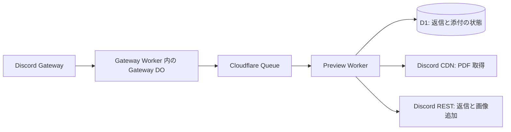

# Discord PDF Preview の実装設計

2026-10-23 時点の実装案。
利用者と合意した振る舞いは [設計上の合意](design.md)、ライブラリの検証結果は [技術検証](../spike/README.md) に記録する。
この文書の構成と初期値を実装し、ローカル workerd の模擬 Discord で統合検証した。
2026-10-24 に両 Worker、Queue、D1 を Cloudflare 本番へデプロイした。
実際の Discord 投稿による PDF の送受信確認は残っている。

## 実行構成



Worker は2つに分ける。
Gateway Worker に接続管理用の DO を置き、Preview Worker を Queue Consumer とする。
各 Worker が別の isolate で動くため、同期的な WASM の描画が Gateway の Heartbeat を止めない。

| 部品 | 所有する責務 | 保存するもの |
|---|---|---|
| Gateway DO | 接続、Heartbeat、再接続、対象イベントの Queue への引き渡し | Gateway セッション、sequence、未引き渡しの添付メタデータ |
| Queue | 添付単位の配送、再試行の待ち時間 | 元メッセージと添付のメタデータ |
| Preview Worker | PDF 取得、描画、PNG 化、返信、再試行判断 | PNG は処理中のメモリだけに保持 |
| D1 | 返信の識別、添付の進捗、送信操作の記録、処理権の取得 | ID、状態、時刻、Discord 添付 ID |

画像保存用の R2 と、プレビュー管理用の別 DO は初期構成に含めない。
送信済み画像は Discord が保持するため、追加時は既存添付 ID を指定し、新しい PNG だけをアップロードする。
明確な送信失敗から再試行するときは PDF を再取得して PNG を再生成する。
画像保存の基盤を追加するより、今回確認した変換時間の範囲で再生成する案を採る。

## Gateway の接続と引き渡し

Bot 全体で1つの Gateway DO を使う。
決定的な名前で取得し、初期構成では Discord の shard は1つとする。
Outbound WebSocket は Hibernation を使わず、Hello が指定する間隔で Heartbeat を送る。
ACK が来ない接続は切り直し、可能なら Resume、不可なら Identify へ進む。
接続世代の番号を使い、古いソケットのイベントや再接続タイマーが現行接続を変更しないようにする。

Gateway Worker の Cron を1分間隔で動かし、`ensureConnected()` を呼ぶ。
これは接続開始と切断時の復旧用であり、既存接続を毎分作り直す処理にはしない。
Identify の再実行には Discord の session start limit と接続プロトコルの制約を適用する。

対象は人による `MESSAGE_CREATE` の PDF 添付だけとする。
Bot 自身、他の Bot、Webhook のイベントは Queue に入れない。
拡張子または MIME 型で PDF 候補を選び、実際に読める PDF かどうかは PDFium で判定する。
添付のないメッセージと編集イベントには処理を起こさない。

Guild 用には `GUILDS`、`GUILD_MESSAGES`、`MESSAGE_CONTENT` を有効にする。
DM も扱う場合は `DIRECT_MESSAGES` を追加する。
Bot の権限は View Channel、Read Message History、Send Messages、Attach Files とし、スレッドには Send Messages in Threads も必要になる。

対象イベントは、DO の SQLite に未引き渡しデータを保存してから Queue に送る。
PDF ごとに Queue メッセージを作り、送信成功後に未引き渡しデータを消す。
対象イベントの永続化を終える前に、Resume 用の保存済み sequence を先へ進めない。
引き渡しと同じクリティカルセクションをネットワーク完了まで保持せず、Heartbeat を継続できるようにする。

Queue 送信後に DO が落ちると重複配送する場合があるが、Preview 側の ID で吸収する。
接続復旧時と Cron の呼び出し時に未引き渡しデータを再送し、10分の期限を過ぎたものは削除する。
Gateway の再接続と Queue への引き渡し再試行には DO の alarm を共用し、次に必要な最も早い時刻を1件だけ登録する。

Resume が成立しない場合、チャンネル履歴を走査して未受信投稿を補完する機能は初期実装に含めない。
長時間切断中の取り逃しまで保証する設計ではない。

## Queue のメッセージ

1メッセージを1添付に対応させる。
同じ元メッセージの PDF が3つなら、Queue には3件を送る。
添付全体のメタデータも含め、どの添付が先に届いても返信の初期状態を作れるようにする。

```ts
type PreviewTask = {
  version: 1;
  source: {
    messageId: string;
    channelId: string;
    guildId?: string;
    postedAt: number;
  };
  attachmentId: string;
  pdfs: Array<{
    id: string;
    filename: string;
    url: string;
    sourceIndex: number;
    size: number;
  }>;
};
```

PDF と PNG のバイナリ、Bot token は Queue に入れない。
`expiresAt = postedAt + 10分` は Consumer が算出し、再試行のたびに更新しない。
添付 URL は期限切れや削除で取得できなくなることがあるため、取得失敗時には元メッセージを再取得して同じ添付 ID の URL を更新する。
元メッセージにも添付が見つからなければ、その添付の処理を終了する。

初期設定は `max_batch_size = 1`、`max_batch_timeout = 1`、`max_concurrency = 1` とする。
1件の処理中に次の PDF を同時描画せず、待ち時間は Queue に戻して別の添付を進める。
Consumer の CPU 上限は30秒を初期値とする。
実際のプラン上限は、本番のメトリクスで確認する。

## D1 の状態

返信の識別子は元メッセージ ID、添付の識別子は元メッセージ ID と添付 ID の組とする。
重複した Queue メッセージを受けても、`INSERT ... ON CONFLICT DO NOTHING` で既存状態を維持する。

| テーブル | 主な項目 |
|---|---|
| `preview_jobs` | `source_message_id` PK、`channel_id`、`expires_at`、`reply_message_id`、`status`、`lease_token`、`lease_until` |
| `preview_items` | `(source_message_id, attachment_id)` PK、`filename`、`source_index`、`status`、`next_attempt_at`、`target_long_edge`、`discord_attachment_id`、`last_error_kind` |
| `send_operations` | `operation_id` PK、`source_message_id`、`attachment_id`、`kind`、`status`、`started_at`、送信前と送信予定の添付一覧 |
| `discord_cooldowns` | API bucket または global のキー、再送可能な時刻 |
| `discord_routes` | チャンネル ID と観測した API bucket の対応 |

初期の添付状態は `pending`、途中状態は `rendering` と `sending`、終了状態は `sent`、`failed`、`expired` とする。
返信全体の状態は `active`、`complete`、`cancelled`、`expired`、`delivery_unknown` とする。

D1 の条件付き UPDATE で元メッセージ単位の処理権を取得する。
条件に一致した行数が0なら、その Consumer は送信しない。
処理権の初期有効期間は120秒とし、取得、描画開始、送信直前の時点で更新または所有権を確認する。
ネットワーク待ちには30秒を上限とするタイムアウトを設ける。
既に `sending` の操作が残っていれば、処理権の期限切れだけを根拠に再送せず、後述の結果確認へ進む。

返信 ID と添付 ID の確定は D1 の batch でまとめる。
更新には処理権の token を条件に含め、古い処理が新しい状態を上書きしないようにする。
送信操作の作成にも、有効な処理権と未確定の送信操作が存在しないことを条件として含める。
条件を満たして操作を1件作成できた場合だけ、Discord への書き込みを開始する。
Queue の同時実行数1は処理量の制御に使い、デプロイや再配送を含む重複防止は D1 の状態で判断する。

すべての添付が終了状態になったら job を `complete` にする。
成功分があっても、再試行中の添付が残る間は `active` を維持する。
終了した記録は24時間保持し、Preview Worker の日次 Cron で削除する。
Cron は先に期限を過ぎた active job を終了状態にし、配送が途絶えた記録も清掃対象にする。
期限内の `sending` は清掃しない。
24時間後に古い Queue メッセージが届いても、元の投稿時刻で期限切れを判定して終了する。

## 添付1個の処理

1. 投稿から10分を過ぎていたら、描画せず終了する。
2. D1 を初期化し、処理権を取得する。
3. 終了済みの添付、または終了済みの返信なら ACK する。
4. 未確定の送信操作があれば先に結果を確認する。
5. Discord の cooldown と添付の再試行時刻を確認する。
6. PDF をダウンロードし、1ページ目だけを PNG にする。
7. 返信がまだなければ元メッセージの存在を確認する。
8. 期限と処理権を再確認し、送信操作を永続化してから返信または画像追加を行う。
9. 成功レスポンスの返信 ID と添付 ID を保存してから ACK する。
10. 再試行が必要なら状態を保存し、Queue の `retry({ delaySeconds })` で待つ。

送信前の確認で元メッセージが404なら、未返信の job を `cancelled` にする。
返信作成時にも `message_reference.fail_if_not_exists = true` を指定し、存在確認後に削除された場合に通常投稿へ変わらないようにする。
返信後に元メッセージが消えても、既存返信は消さない。
既存返信への画像追加は継続可能とし、元 PDF の取得ができなくなった添付だけを終了する。
Bot の返信そのものが削除された場合は、再作成せず job を終了する。

## 描画と添付追加

検証で動いた静的 WASM import と `instantiateWasm` をそのまま使う。
初期化済み PDFium は isolate 内で再利用し、各 document は `finally` で破棄する。
入力 PDF、描画用バッファ、現在の PNG だけを保持し、送信後は参照を解放する。
Worker 独自の入力 PDF サイズ上限は設けない。

長辺は最大1200 px、背景は白、PNG の RGBA を初期形式とする。
縦横比から整数の幅と高さを求め、各辺を少なくとも1 pxにする。
入力 PDF 内の巨大な画像を PDFium が展開する負荷は、描画サイズだけでは抑えられない。
Paid でもメモリ上限は変わらないため、リソース超過の実測とログを残す。
変換中にランタイムが中断した添付は、次の配送で中断を検出し、同種の中断が続く場合は失敗として終了する。
この中断については最初の1回だけ再試行し、2回目の中断で終了する初期値とする。
中断回数は D1 に保存し、Consumer の再起動でリセットしない。

最初の成功した PNG で返信を作り、後続の成功分は同じ返信を編集して追加する。
これにより複数 PDF の PNG を同時に保持しない。
表示順は元の添付順に揃え、同名 PDF は添付 ID を含む出力名で識別する。
画像追加時の `attachments` には既存添付と新規添付をすべて指定し、既存の PNG は再アップロードしない。
投稿者へのメンションは送らない。

画像サイズが原因で Discord が送信を拒否した場合だけ、長辺を0.75倍にして再生成する。
1 pxまで縮小してもサイズが原因で送れなければ、その添付を失敗として終了する。
添付件数超過など縮小で解決しない拒否は再描画しない。
レスポンスが示す制限を使い、上限バイト数を固定で決め打ちしない。

## 再試行と送信結果の確認

| 発生箇所と結果 | 判断 |
|---|---|
| PDF の GET で通信失敗または5xx | 期限内で再試行 |
| URL の取得失敗 | 元メッセージから URL を更新して再試行。元添付がなければ終了 |
| PDF の破損またはパスワード要求 | 当該添付を終了 |
| Discord の429 | `retry_after` を優先して Queue で待つ |
| Discord の403または回復不能な4xx | ログを残して当該処理を終了 |
| PNG サイズに起因する拒否 | 縮小して再生成 |
| Discord の書き込みで通信切断、5xx、Consumer 中断 | 送信結果不明として確認し、盲目的に再送しない |
| Discord 成功後に D1 更新が失敗 | 未確定の送信操作から結果を確認する |

通常の再試行間隔は5秒から増やし、最大60秒とする。
HTTP の待ち時間を Queue で扱うため、Consumer 内で長い sleep は行わない。
429 の global と bucket ごとの cooldown は D1 に保存し、別添付の Consumer にも適用する。
次回の再試行が期限を超えるなら終了する。
Queue の再試行回数は100を上限として構成し、通常の終了条件は投稿時刻から10分とする。

Discord への書き込み前に `send_operations` を `sending` として確定する。
保存が失敗した場合は送信しない。
保存後に実際の送信を開始する前に落ちた場合も結果不明になり得るが、未送信を許容して重複を避ける合意に合わせる。

初回返信には元メッセージ ID から決まる `nonce` と `enforce_nonce` を指定する。
Discord の nonce 重複検査は直近数分が対象なので、10分の処理全体を保証する手段にはしない。
作成結果が不明なら、チャンネルの直近最大100件から Bot 作者、元メッセージ参照、出力ファイル名が一致する返信を探す。
同定できれば D1 に採用し、同定できなければ job を `delivery_unknown` として終了する。
不在を確認できたことと、絶対に作成されていないことは同一視しない。

画像追加の結果が不明なら、既知の返信 ID を GET して、予定した添付が存在するか確認する。
確認できれば進捗を確定する。
確認できない場合は job を `delivery_unknown` として終了し、古いリクエストとの競合を避けるため後続の画像追加も行わない。
照合のための GET だけが一時失敗した場合は、期限内で照合を再試行できる。
期限後は新たな送信や画像追加をせず、ACK とログだけで終了する。

## モジュール構成

```text
src/
  gateway/
    worker.ts           Cron と接続開始の入口
    gateway.ts          Gateway DO と接続状態機械、未引き渡しデータ
    events.ts           MESSAGE_CREATE から PreviewTask を作る純粋関数
  preview/
    worker.ts           Queue と清掃 Cron の入口
    process.ts          添付1個の処理手順と再試行判断
    state.ts            状態、条件付き更新、送信操作の永続化
    render.ts           PDFium と PNG、メモリ解放
    discord.ts          REST、結果分類、添付保持、結果照合
  shared/
    task.ts             Queue に渡す契約と検証
wrangler.gateway.jsonc
wrangler.preview.jsonc
migrations/
```

Gateway は Preview の内部状態を参照しない。
Preview は Gateway DO を呼び戻さない。
再試行と送信可否の最終判断は `process.ts` に置き、REST モジュールは結果を分類して返す。
WASM モジュールには再試行判断を持たせない。
HTTP クライアント内の自動再送は無効にして、結果不明の書き込みを隠れて再送しないようにする。

設計の責務境界を点検すると、Gateway と Preview が共有するのは不変な Queue 契約だけであり、Preview から Gateway への逆向きの依存はない。
返信可否の判断は処理手順、排他と永続化は状態モジュール、外部 API の結果分類は REST モジュールが所有する。
実装でも Gateway から Preview への共有は Queue 契約に限定し、WASM の import は Preview Worker 内に閉じている。

## 実装済みの検証

`npm test` は本番の SQL を SQLite で実行し、重複配送、部分成功、送信応答消失、送信成功後の D1 障害、期限切れ、削除、429、縮小、処理権の競合と清掃を検査する。
`npm run test:integration` はローカル workerd の WebSocket、実際の Queue と D1 binding、両 WASM ライブラリを通し、模擬 Discord への返信を確認する。
この統合テストには Resume、Invalid Session 後の Identify、Heartbeat ACK、成功応答が失われた書き込みの照合も含める。
Node の fetch と workerd の差に合わせて、外部 HTTP は `redirect: "manual"` と応答検査を使う。

## 設定とログ

Cloudflare Workers Builds で、両 Worker を GitHub の `chikina-dev/discord-pdf-preview` の `main` に接続する。
push ごとに `npm run check` を実行し、成功した Worker だけを本番へデプロイする。
Preview は `npm run deploy:preview` で D1 migration を適用してからデプロイし、Gateway は `npm run deploy:gateway` を使う。
Gateway のデプロイでは DO のコード更新を `immediate` に指定し、既存接続も保存済みセッションから修正版で再接続する。
プレビューブランチの自動デプロイは無効とし、Bot token は Cloudflare の実行時 secret を保持する。
両 Worker のビルドは独立するため、Queue の契約変更では新旧コードの互換性を維持する。

Bot token は各 Worker の secret に設定する。
Gateway に Preview 用の D1 binding は持たせず、Preview に Gateway DO binding は持たせない。
Gateway 用 DO の SQLite migration と Preview 用 D1 migration を、それぞれの設定で管理する。

ログは元メッセージ ID、添付 ID、処理段階、試行回数、経過時間、結果分類を構造化して出す。
Bot token、PDF 本文、署名付き添付 URL は出さない。
通常の失敗と期限切れは Discord へ通知せず、ログから確認する。
Gateway 接続状態と、Preview の CPU 超過およびメモリ超過の outcome は Cloudflare 側でも確認できるようにする。

## 実装と確認の順序

1. Queue 契約、D1 migration、期限と状態遷移を作る。
2. 検証コードの renderer を移し、元 PDF の順序と出力名を整える。
3. Discord REST と返信作成、既存添付を残した編集を実装する。
4. Queue Consumer に取得、描画、状態確定、再試行を接続する。
5. Gateway の接続状態機械と永続的な引き渡しを実装する。
6. 隔離した Discord チャンネルで接続と返信を実環境確認する。

自動検証では Queue 再配送、初回返信後の中断、PATCH 後の D1 更新失敗、期限直前、元投稿削除、429、複数 PDF のうち1個だけ失敗、遅延後の添付追加を重点にする。
Gateway は ACK 欠落、Resume、Invalid Session、再接続中の古いイベント、Queue 引き渡し途中の再起動を検査する。
メモリ超過を通常の例外として捕捉できるとは仮定せず、クラウドの outcome と再配送時の状態から中断を観測する。

## 公式資料

- [Discord Gateway](https://docs.discord.com/developers/events/gateway): Heartbeat、Resume、Identify、Intents。
- [Discord Message](https://docs.discord.com/developers/resources/message): 返信、`fail_if_not_exists`、nonce、添付を保持した編集。
- [Discord Rate Limits](https://docs.discord.com/developers/topics/rate-limits): `retry_after`、global と bucket の区別。
- [Queues の再試行](https://developers.cloudflare.com/queues/configuration/batching-retries/): メッセージ単位の ACK と遅延再試行。
- [D1 の prepared statements](https://developers.cloudflare.com/d1/worker-api/prepared-statements/): 条件付き更新と更新行数の確認。
